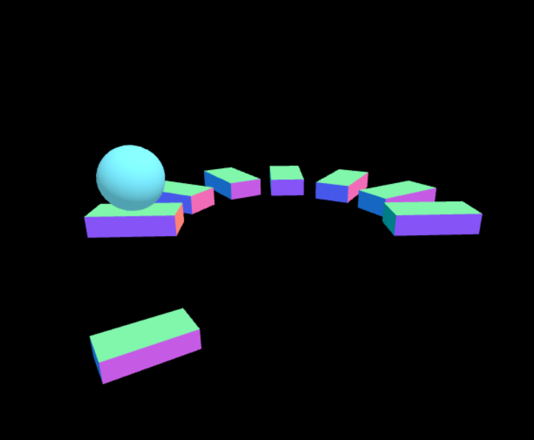

# Animación 3D Interactiva: Anillo de Plataformas y Esfera Saltarina

Este proyecto implementa una escena interactiva 3D con **Three.js**, **Ammo.js** (físicas) y **Tween.js** (animaciones de movimiento). En la escena, una esfera salta secuencialmente a lo largo de una disposición circular de rectángulos (plataformas). A medida que la esfera salta, las plataformas colapsan en caída libre y posteriormente vuelven a ascender suavemente a su posición original.

---

## 1. Disposición Escénica Inicial

### Disposición de las Plataformas y la Esfera
Para formar el anillo, se colocó el primer rectángulo y, manteniendo una separación equidistante entre cada uno, se calcularon secuencialmente las posiciones y rotaciones del resto. La esfera (`circulo`) se ubicó inicialmente sobre la primera plataforma.

```javascript
rectangulos.push(Cubo(13.0, 0.5, -3.5, 4, 1, 2, 0, -180, 0, 0));
rectangulos.push(Cubo(12.0, 0.5,  0.0, 4, 1, 2, 0, -210, 0, 0));
rectangulos.push(Cubo(9.0,  0.5,  2.5, 4, 1, 2, 0, -240, 0, 0));
rectangulos.push(Cubo(5.5,  0.5,  3.0, 4, 1, 2, 0, -270, 0, 0));
rectangulos.push(Cubo(2.5,  0.5,  2.0, 4, 1, 2, 0, -300, 0, 0));
rectangulos.push(Cubo(0.0,  0.5,  0.0, 4, 1, 2, 0,   30, 0, 0));
rectangulos.push(Cubo(-1.0, 0.5, -4.0, 4, 1, 2, 0,    0, 0, 0));
rectangulos.push(Cubo(0.0,  0.5, -8.0, 4, 1, 2, 0,  -30, 0, 0));
rectangulos.push(Cubo(3.0,  0.5, -11.0,4, 1, 2, 0,  -60, 0, 0));
rectangulos.push(Cubo(6.5,  0.5, -11.5,4, 1, 2, 0,  -90, 0, 0));
rectangulos.push(Cubo(10.0, 0.5, -10.0,4, 1, 2, 0, -120, 0, 0));
rectangulos.push(Cubo(12.5, 0.5, -7.0, 4, 1, 2, 0, -150, 0, 0));

circulo = Circulo(13.3, 2.5, -3.5, 1.5, 16, 16, 0xffaa00, 0);
```

---

## 2. Origen del Código Base

### 2.1. Construcción de la Esfera (`Circulo`)
La función para generar la esfera se adaptó a partir de la función `Planeta` trabajada en la Semana 6:

*Código base de origen (Semana 6):*
```javascript
function Planeta(px, py, pz, radio, nx, ny, col) {
  let geometry = new THREE.SphereBufferGeometry(radio, nx, ny);
  // Material con o sin relleno
  let material = new THREE.MeshBasicMaterial({
    color: col,
    // wireframe: true, // Descomenta para activar modelo de alambres
  });

  let mesh = new THREE.Mesh(geometry, material);
  mesh.position.set(px, py, pz);
  scene.add(mesh);
  Planetas.push(mesh);
}
```

### 2.2. Lógica del Salto Circular
Para la trayectoria del salto de la esfera, se partió del código de movimiento de órbita elíptica desarrollado en la Semana 6:

*Código base de origen (Semana 6):*
```javascript
planeta.position.x =
  Math.cos(timestamp * planeta.userData.speed) * planeta.userData.dist * planeta.userData.f1;
planeta.position.y =
  Math.sin(timestamp * planeta.userData.speed) * planeta.userData.dist * planeta.userData.f2;
```

---

## 3. Funcionalidades Añadidas y Mejoras del Proyecto

### 3.1. Caída Física de Rectángulos (Ammo.js)
Cuando la esfera despega de una plataforma (`progresoSalto > 0.25`), el rectángulo pasa de ser un objeto estático a uno dinámico impulsado por gravedad. 

**Solución al problema de estático a dinámico en Ammo.js:** En Ammo.js, modificar la masa de un cuerpo en vivo no refresca automáticamente su presencia en las listas internas de cuerpos rígidos del mundo físico. Para solucionarlo, eliminamos el cuerpo con `removeRigidBody(body)`, cambiamos sus propiedades de masa y banderas de colisión, y lo volvemos a insertar con `addRigidBody(body)`:

```javascript
function soltarRectangulo(mesh) {
  if (!mesh || mesh.userData.cayendo || mesh.userData.subiendo) return;
  mesh.userData.cayendo = true;

  const body = mesh.userData.physicsBody;
  if (!body) return;

  physicsWorld.removeRigidBody(body);

  const masa = 2;
  const localInertia = new Ammo.btVector3(0, 0, 0);
  body.getCollisionShape().calculateLocalInertia(masa, localInertia);

  body.setCollisionFlags(0);
  body.setMassProps(masa, localInertia);
  body.updateInertiaTensor();

  physicsWorld.addRigidBody(body);
  body.activate(true);
}
```

---

### 3.2. Retorno Suave y Progresivo de las Plataformas (TWEEN.js)
Tras 6 pasos del círculo, las plataformas caídas retornan a su posición inicial. 

**Ajuste de velocidad y trayectoria:**
* Se cambió la curva de suavizado a `TWEEN.Easing.Quadratic.Out` para evitar que la plataforma supere su altura objetivo ( overshoot).
* Se amplió el tiempo de animación a `2000 ms` para que el movimiento de ascenso sea gradual y fluido.

```javascript
function subirRectangulo(mesh) {
  if (!mesh || !mesh.userData.cayendo || mesh.userData.subiendo) return;

  mesh.userData.cayendo = false;
  mesh.userData.subiendo = true;

  const body = mesh.userData.physicsBody;
  if (body) {
    physicsWorld.removeRigidBody(body);

    const zero = new Ammo.btVector3(0, 0, 0);
    body.setLinearVelocity(zero);
    body.setAngularVelocity(zero);
    body.setMassProps(0, zero);
    body.setCollisionFlags(1);

    physicsWorld.addRigidBody(body);
  }

  mesh.quaternion.set(
    mesh.userData.rotInicial.x,
    mesh.userData.rotInicial.y,
    mesh.userData.rotInicial.z,
    mesh.userData.rotInicial.w
  );

  const alturaInicio = Math.max(mesh.position.y, -12);
  const posActual = { x: mesh.position.x, y: alturaInicio, z: mesh.position.z };
  const destino = mesh.userData.posInicial;

  new TWEEN.Tween(posActual)
    .to({ x: destino.x, y: destino.y, z: destino.z }, 2000)
    .easing(TWEEN.Easing.Quadratic.Out)
    .onUpdate(() => {
      mesh.position.set(posActual.x, posActual.y, posActual.z);

      if (body) {
        let transform = new Ammo.btTransform();
        transform.setIdentity();
        transform.setOrigin(new Ammo.btVector3(posActual.x, posActual.y, posActual.z));
        transform.setRotation(
          new Ammo.btQuaternion(
            mesh.quaternion.x,
            mesh.quaternion.y,
            mesh.quaternion.z,
            mesh.quaternion.w
          )
        );
        body.setWorldTransform(transform);
        body.getMotionState().setWorldTransform(transform);
      }
    })
    .onComplete(() => {
      mesh.userData.subiendo = false;
    })
    .start();
}
```

---

### 3.3. Sistema de Iluminación y Sombreado 3D
Para pasar de materiales planos (`MeshBasicMaterial`) a volúmenes 3D realistas, se incorporaron fuentes de luz en la función `init()` y se migró el material de la esfera a `MeshStandardMaterial`.

```javascript
const luzAmbiental = new THREE.AmbientLight(0xffffff, 0.5);
scene.add(luzAmbiental);

const luzDireccional = new THREE.DirectionalLight(0xffffff, 1);
luzDireccional.position.set(10, 20, 10);
scene.add(luzDireccional);

let material = new THREE.MeshStandardMaterial({
  color: col,
});
```

---

### 3.4. Cambio Aleatorio de Color en Cada Salto
Para aportar dinamismo visual, la esfera cambia su color a una tonalidad aleatoria cada vez que efectúa un nuevo salto (`pasoActual` avanza).

```javascript
let ultimoPaso = -1;

const pasoActual = Math.floor(segundos / duracionCiclo);

if (pasoActual !== ultimoPaso) {
  ultimoPaso = pasoActual;

  circulo.material.color.setHex(Math.random() * 0xffffff);
}
```

## Resultado:
  

## Uso IA

La IA en este trabajo principalmente se utilizó para mejorar el código a la hora de su legibilidad. En los aspectos utilizados son en la caída, subida de los bloques y además a la hora de poder hacer el salto con un tween único.
